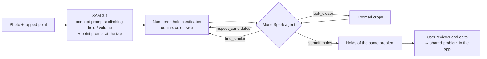

# topo-agent

**Tap one hold. Get the whole boulder problem.**

A topo agent for bouldering gyms, built for the Meta Global AI Developer Hackathon (Oct 27 – Nov 4, 2026).
Snap a photo of the wall and tap one hold. **SAM 3.1** outlines every hold, then a **Muse Spark** agent uses tools
to inspect, compare and zoom in, and picks only the holds that belong to the same problem.
The resulting topo becomes a problem that climbers can share in [Mirai Climbing](https://mirai-climbing.com/), a climbing app.

## Why an agent?

In a gym, one problem is marked by holds of the same color, or by tape of the same color next to holds of any color.
A color filter alone gets this wrong in exactly the cases that matter:

- the same color appears on the next wall, in a different problem
- tape problems: the holds themselves are all different colors
- uneven light, shadows under volumes, washed-out highlights

The agent looks at the photo and decides. Color is a tool it can use, not the answer.

## How it works



1. **SAM 3.1** (Meta Model API, Responses) segments every hold with the concept prompts `climbing hold` and
   `climbing volume`, plus a point prompt at the tapped spot, all in parallel. Masks are decoded with Meta's
   `meta-sam-parser` and turned into outlines. ([`topo_agent/sam.py`](topo_agent/sam.py))
2. The agent gets the photo and a second image with every candidate outlined and numbered, so it can talk in ids
   instead of guessing coordinates.
3. **Muse Spark** (`muse-spark-1.3`, Chat Completions with tool calling) picks its own tools:
   - `inspect_candidates(ids)`: color name, hue, saturation, value, size, position, SAM confidence
   - `find_similar(id)`: candidates with a close color, closest first, with distance on the wall
   - `look_closer(ids)`: zoomed crops returned as an image (tape, shadows, highlights)
   - `submit_holds(ids, note)`: the answer, with one sentence on how it decided
   ([`topo_agent/agent.py`](topo_agent/agent.py))
4. The user always has the last word: the answer is shown as outlines the user can add to or remove.

### Guardrails

- At most 6 model turns and 8 tool calls per turn; at most 60 holds in an answer. Unknown ids are dropped,
  and the tapped hold is always included.
- Text inside the photo that looks like instructions is ignored (stated first in the system prompt).
- Only the photo and the candidates are sent. No names, no user data. Requests use `store: false`.
- If Muse Spark fails, the answer falls back to SAM candidates filtered by color (`sam_color`);
  if SAM fails too, to the pre-hackathon color-only method.
- Every step is traced (tool, arguments, result summary, milliseconds), so the app can show how the agent decided.

## Results so far

Hard sample walls drawn by code ([`topo_agent/baseline/bench.py`](topo_agent/baseline/bench.py)), 9 scenes × seed 11,
7 marked holds each. One run per method, so treat small differences with care.

| Method | Recall | Precision | Seconds / photo |
|---|---|---|---|
| `color`: color only (pre-hackathon) | 89% | 97% | 0.9 |
| `sam_color`: SAM 3.1 + color filter, no agent | 90% | 85% | 2.1 |
| **`meta`: SAM 3.1 + Muse Spark agent** | **94%** | **100%** | 36 |

- **Tape problems: recall 14% → 100%.** Hold colors are mixed and only the tape tells the problem apart, so color
  filters fail while the agent reads the photo.
- The agent never added a hold from another problem (precision 100%), while `sam_color` picked up the same-color
  problem on the next wall.
- Still to improve: speed (36 s per photo), a same-color problem far away (`twins`, where the agent sometimes drops
  distant holds), and one washed-out hold that SAM missed (`light`).
- Next: real gym photos (with the photographers' consent) and the pre-hackathon Gemini agent in the same table.

## Run it

```bash
python -m venv .venv
.venv/Scripts/pip install -e .    # Windows; use .venv/bin/pip elsewhere
.venv/Scripts/python -m unittest discover -s tests -t .
```

Tests use a fake SAM and a fake Muse Spark, so they need no key. To call Meta Model API, set `MODEL_API_KEY`:

```bash
python -m topo_agent.sam photo.jpg "climbing hold"
python -m topo_agent.eval --bench --methods color,sam_color,meta --seeds 11
```

## What was built during the hackathon

Everything except `topo_agent/baseline/` was written during the hackathon (from Oct 27, 2026).

- **`topo_agent/baseline/` is pre-hackathon code**, imported from the Mirai Climbing app (private repo) in the
  first commit, with only import paths adjusted, tagged [`pre-hackathon`](https://github.com/Mirai-Climbing/topo-agent/tree/pre-hackathon):
  the color-based outline code, the hard sample walls, and a **Gemini-based hold agent that was built for an earlier
  hackathon**. It is kept only as a baseline to compare against.
- The scoring code in `topo_agent/eval.py` started from the app's evaluation script (also in the first commit)
  and was extended during the hackathon with the `sam_color` and `meta` methods.
- New during the hackathon: `topo_agent/sam.py` (SAM 3.1), `topo_agent/agent.py` (Muse Spark agent),
  their tests, and this README. See the commit history after the `pre-hackathon` tag.

## License

AGPL-3.0-or-later (see [COPYING](COPYING)).
